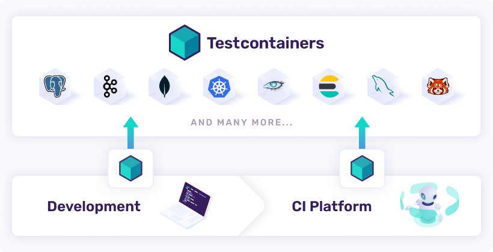

Testcontainers is a testing library that provides easy and lightweight APIs for bootstrapping integration tests with real services wrapped in Docker containers. Using Testcontainers, you can write tests talking to the same type of services you use in production without mocks or in-memory services.

A typical Testcontainers-based integration test works as follows:

- **Before Tests:**
    - Start your required services (databases, messaging systems etc.) docker containers using Testcontainers API.
    - Configure or update your application configuration to use these containerized services.
    
- **During Tests:**
    - Your tests will run using these containerized services.
    
- **After Tests:**
    - Testcontainers will take care of destroying those containers irrespective of whether tests executed successfully or there are any test failures.

## Benefits


By using Testcontainers:
- You don’t need to have a pre-provisioned integration testing infrastructure. The Testcontainers API will provide the required services before running our tests. The code for defining the infrastructure resides directly next to the actual test code.
- There will be no data conflict issues, even when multiple build pipelines run in parallel because each pipeline runs with an isolated set of services.
- You can run your integration tests right from your IDE, just like you run unit tests. No need to push your changes and wait for CI to run your integration tests.
- After test execution, Testcontainers take care of cleaning up the containers automatically.
    
You can use Testcontainers with many popular programming languages, including **Java**, **.NET**, **Go**, **NodeJS**, **Rust**, and **Python**, and more language support on its way.

## References

```cardlink
url: https://testcontainers.com/guides/introducing-testcontainers/
title: "What is Testcontainers, and why should you use it?"
description: "This guide will introduce you to Testcontainers and explains what kind of problems Testcontainers solves."
host: testcontainers.com
favicon: https://testcontainers.com/favicon.ico
image: https://testcontainers.com//images/share-image.png
```
